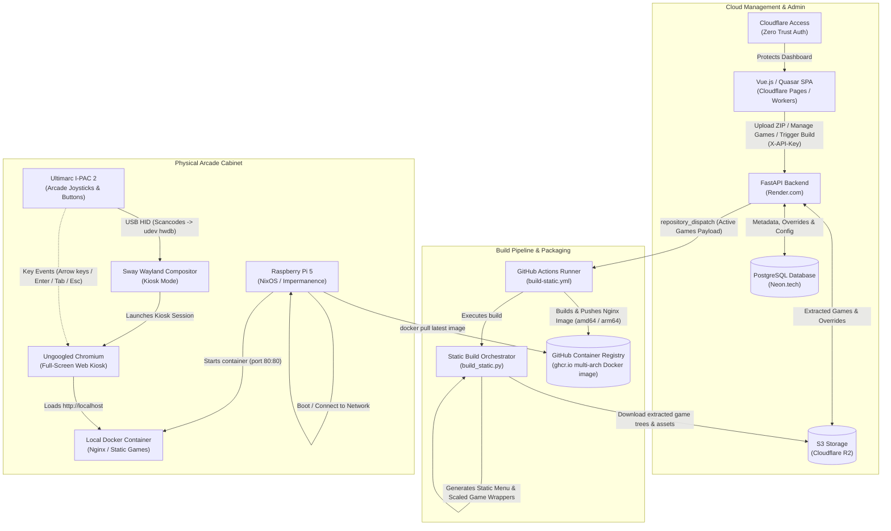

# System Architecture: UAntwerpen Arcade Cabinet

## 1. Executive Summary

The **UAntwerpen Arcade Cabinet** ("UAntwerpen Arcade kast") is an end-to-end IoT and web gaming platform created for the University of Antwerp by Thomas More Digital Innovation students. The project bridges modern web technologies with physical arcade gaming hardware.

The platform allows administrators, lecturers, and students to:
1. **Upload web-based games** (HTML5, JavaScript, Phaser, Canvas) packed as ZIP archives.
2. **Inspect and customize game assets** (textures, audio, sprites) through a web dashboard.
3. **Automatically convert internet-dependent games into 100% offline-compatible bundles** (downloading CDNs, fonts, and media into local bundles).
4. **Compile the collection into a self-contained static kiosk image** via GitHub Actions.
5. **Run the games seamlessly on a custom-built Raspberry Pi 5 arcade cabinet** powered by NixOS, Sway (Wayland), Docker, and an Ultimarc I-PAC 2 arcade controller.

---

## 2. High-Level System Architecture

The following diagram illustrates the complete architectural lifecycle, matching and extending the system design outlined in [`documents/diagram.png`](diagram.png):

---

## 3. Core Architectural Subsystems

### 3.1. Frontend Management Portal (`code/frontend`)
- **Technology**: Vue 3, Quasar Framework v2, Vite, TypeScript, Tailwind CSS, Pinia.
- **Hosting**: Deployed as a static Single Page Application (SPA) on **Cloudflare Workers / Pages** using Wrangler.
- **Primary Capabilities**:
  - **Game Catalog**: Displays active and inactive games with live toggle switches.
  - **Game Ingestion**: Uploads `.zip` archives of web games to the backend.
  - **Asset Inspector & Replacement**: Scans uploaded game packages for image and audio assets, displays original files alongside uploaded replacements with resolution dimensions, and allows uploading asset overrides.
  - **In-Browser Game Tester**: Emulates arcade scaling and resolution inside a responsive iframe with auto-detected canvas sizing and dynamic scale transformation.
  - **Cabinet Synchronization ("Update Pi")**: Dispatches a remote build trigger to the backend and monitors the GitHub Actions progress in real-time.

### 3.2. Backend API & Storage Engine (`code/backend`)
- **Technology**: Python 3.10+, FastAPI, SQLAlchemy, PostgreSQL (hosted on Neon.tech), Cloudflare R2 (S3-compatible object storage via `s3fs`), PyGithub.
- **Hosting**: Render.com (or containerized web service).
- **Primary Capabilities**:
  - **Authentication & Security**: Multi-tier API key security supporting HTTP headers (`X-API-Key`), query parameters, secure cookies, and referer inspection for nested iframe sub-assets.
  - **ZIP Processing & Asset Localization**: Unpacks game files, scans code for external HTTP(S) dependencies (scripts, styles, fonts, audio), downloads them locally into `_downloaded_assets/`, and rewrites the source code so games run 100% offline.
  - **Asset Override Engine**: Dynamically routes asset requests: if an administrator uploaded a custom asset for a game, the backend serves the replacement; otherwise, it serves the original extracted asset.
  - **CI/CD Dispatcher**: Generates an authoritative database snapshot of active games and asset overrides, authenticating as a GitHub App to trigger the static build workflow.

### 3.3. Build Pipeline & Image Distribution (`.github/workflows` & `build_static.py`)
- **Technology**: GitHub Actions (`build-static.yml`), Python `build_static.py`, Docker Buildx, Alpine Nginx, GitHub Container Registry (GHCR).
- **Build Lifecycle**:
  1. Triggered via `repository_dispatch` with event payload containing active games and overrides.
  2. `build_static.py` connects to Cloudflare R2, downloads extracted files for all active games, and flattens directory paths.
  3. Applies asset overrides directly on top of original game assets.
  4. Generates an HTML game wrapper (`game.html`) for each game with auto-scaling logic (`GameWrapper.js`).
  5. Generates the main retro menu (`index.html`) using the `home-screen` template, injecting game metadata into `GAMES_JSON`.
  6. Docker Buildx builds a multi-platform image (`linux/amd64` and `linux/arm64`) using `Dockerfile.static`.
  7. Pushes the compiled image to `ghcr.io/thomas-more-digital-innovation/arcade-cabinet-static:latest`.

### 3.4. Cabinet Client & Operating System (`code/client`)
- **Technology**: Raspberry Pi 5 (ARM64), NixOS 25.11 Flake, Sway (Wayland), Docker, Ungoogled Chromium, Ultimarc I-PAC 2.
- **Cabinet Capabilities**:
  - **Stateless / Impermanent Root**: Root filesystem (`/`) runs entirely in RAM (`tmpfs`), preventing SD card corruption when the arcade machine is powered off via switch. Persistent data (docker cache, network configs, logs) is stored in `/mnt-root/persist`.
  - **Self-Updating Kiosk**: On boot, the startup script checks for internet connectivity, attempts to pull the latest Docker container from GHCR, launches the local Nginx container, and runs Ungoogled Chromium in fullscreen Wayland kiosk mode pointing to `http://localhost`.
  - **Hardware Controls**: Physical arcade joysticks and pushbuttons connect to an Ultimarc I-PAC 2 USB encoder. Scancodes are mapped to Linux keycodes via `systemd-hwdb` / udev rules. Sway binds the arcade `Tab` button to `kill`, enabling players to exit stuck games or return to the main menu.

---

## 4. Security & Authentication Architecture

1. **Cloudflare Access (Zero Trust Authentication - Frontend Only)**:
   - Public access to the **frontend management portal** is fronted by **Cloudflare Access** (Zero Trust application protection).
   - Ensures only authorized university staff, students, and administrators with university credentials can access the dashboard.
   - The backend API is not behind Cloudflare Access; requests between the frontend and the FastAPI backend are directly authenticated using the shared `API_KEY` (`X-API-Key` header) and validated by CORS policies.
2. **API Key & Referer-Based Protection**:
   - Backend administrative endpoints are protected using a shared `API_KEY`.
   - The dependency `get_api_key` supports `X-API-Key` headers, `api_key` query parameters, and secure HTTP cookies.
   - For sub-resources loaded within game preview iframes (e.g. assets, stylesheets, scripts), `Referrer-Policy: no-referrer-when-downgrade` is enforced, allowing child asset requests to inherit authorization from the parent iframe request without exposing credentials.
3. **GitHub App Authentication for Deployment**:
   - The backend connects to GitHub using a dedicated **GitHub App** rather than personal access tokens.
   - **Permissions Required**:
     - `Actions: Read-only` (to inspect workflow runs and poll step progress).
     - `Contents: Read and write` (to dispatch `repository_dispatch` build events).
   - **Credentials Required**:
     - Private key (`.pem`) for asymmetric RS256 token signing.
     - App ID (from the app's General settings).
     - Installation ID (from the organization's installed apps page).
   - Installation access tokens are generated on demand and cached in memory for 30 minutes.
4. **Network Isolation & Local Offline Execution**:
   - The Raspberry Pi arcade cabinet does not depend on cloud connectivity during gameplay.
   - All assets, scripts, and fonts are compiled directly into the local container running on `http://localhost`.
   - If internet access is unavailable on boot, the Pi gracefully skips pulling the latest image and boots immediately into the existing cached local container.
5. **Hardware Filesystem & Tamper Protection**:
   - **Power-off safety**: Traditional Linux distributions suffer SD card corruption when turned off without a clean shutdown. The NixOS configuration uses a `tmpfs` in RAM for `/` and impermanence for state preservation, rendering the arcade cabinet immune to sudden power cutoffs.
   - **Kiosk breakout resilience**: If a user breaks out of the Chromium kiosk instance and gains terminal access, any modifications, file deletions, or system tampering they attempt live only in volatile memory and are completely wiped and reverted upon reboot.

