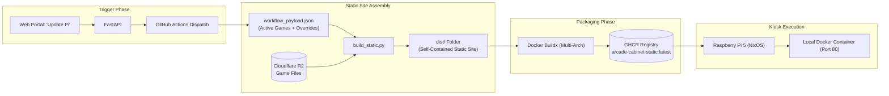

# Static Build Pipeline & Container Deployment

This document explains how the arcade games and menu interface are assembled into a standalone static container, built via **GitHub Actions**, published to the **GitHub Container Registry (GHCR)**, and deployed onto the **Raspberry Pi 5** arcade machine.

---

## 1. Overview & Build Philosophy

The arcade cabinet is designed to operate completely offline. Rather than fetching games dynamically over the internet from an S3 bucket or API at runtime, all active games, retro menus, fonts, scripts, and asset overrides are pre-compiled into a self-contained static site and packaged inside an **Alpine Nginx Docker image**.



---

## 2. GitHub Actions Workflow (`.github/workflows/build-static.yml`)

The workflow is triggered via a `repository_dispatch` event emitted by the FastAPI backend when an administrator clicks "Update Pi".

### Workflow Steps:
1. **Repository Checkout**: Clones the repository code.
2. **Python Setup**: Installs Python 3.10 and required libraries:
   ```bash
   pip install s3fs python-dotenv jinja2
   ```
3. **Payload Ingestion**: Extracts `github.event.client_payload` into `code/backend/workflow_payload.json`:
   ```json
   {
     "games": [
       {
         "id": "27cfaebc-...",
         "name": "UniKong",
         "description": "Climb ladders and avoid rolling barrels!",
         "is_active": true,
         "zip_uploads": [{ "name": "f3b0....zip" }],
         "assets": [{ "original_path": "sprites/hero.png", "path": "s3://..." }]
       }
     ],
     "assets": [...]
   }
   ```
4. **Site Compilation**: Executes `python3 build_static.py` inside `code/backend`, downloading game assets from Cloudflare R2 and assembling the static site.
5. **Docker Build & Push**:
   - Logs into GitHub Container Registry (`ghcr.io`).
   - Uses **Docker Buildx** and **QEMU** for multi-platform compilation (`linux/amd64` and `linux/arm64`).
   - Tags the container as `ghcr.io/thomas-more-digital-innovation/arcade-cabinet-static:latest` and with the commit SHA.

---

## 3. The Static Build Orchestrator (`build_static.py`)

The orchestrator [`code/backend/build_static.py`](../code/backend/build_static.py) performs the heavy lifting of building the offline site:

### 3.1. Directory Flattening
Game ZIP archives often contain arbitrary nested folder structures (e.g., `game-v1.0/game/index.html` or extra folder wrappers). The orchestrator locates the genuine game root and flattens it into `dist/games/<game_id>/`, ensuring relative asset references resolve reliably.

### 3.2. Asset Override Ingestion
For every active game, the orchestrator inspects the payload's `assets` list. If a replacement file was uploaded in the dashboard, the builder downloads the custom file from Cloudflare R2 and overwrites the target file in `dist/games/<game_id>/<original_path>`.

### 3.3. Responsive Game Wrapper (`game.html`)
To prevent HTML5 canvas games from rendering at a tiny resolution or overflowing the display, the builder creates a wrapper for each game based on [`src/home-screen/html/game-wrapper.html`](../code/backend/src/home-screen/html/game-wrapper.html):
- Hosts an `<iframe>` loading the game's actual `index.html`.
- Incorporates [`GameWrapper.js`](../code/backend/src/home-screen/js/GameWrapper.js), which auto-detects internal canvas dimensions, removes internal page margins, and applies a CSS matrix scale transformation to stretch or fit the game to 100vw/100vh.
- Listens for `Escape` or `q` keypresses to navigate back to the main arcade selection menu.

### 3.4. Arcade Home Screen Generation
- Copies retro styling, background art, and the 8-bit arcade font `PressStart2P-Regular.ttf` into `dist/fonts/`, `dist/css/`, and `dist/js/`.
- Reads [`src/home-screen/html/home-screen.html`](../code/backend/src/home-screen/html/home-screen.html).
- Injects JSON metadata for all active games into the `{{GAMES_JSON}}` script placeholder:
  ```json
  [
    {
      "id": "27cfaebc-...",
      "name": "UniKong",
      "description": "Game lore and controls...",
      "index_rel": "index.html",
      "wrapper_url": "games/27cfaebc-.../game.html"
    }
  ]
  ```
- Emits the master arcade menu at `dist/index.html`.

---

## 4. Containerization & Nginx Configuration

The generated `dist/` directory is packaged using [`Dockerfile.static`](../code/backend/Dockerfile.static):

```dockerfile
FROM nginx:alpine

# Copy custom Nginx configuration
COPY nginx.conf /etc/nginx/conf.d/default.conf

# Copy compiled static site
COPY dist /usr/share/nginx/html

EXPOSE 80

CMD ["nginx", "-g", "daemon off;"]
```

### Nginx Routing (`nginx.conf`)
- Serves static files directly with `index.html` fallback.
- Adds caching headers (`expires 1d`, `add_header Cache-Control "public, no-transform"`) for game assets under `/games/`.
- Includes error page redirects (`50x.html`).

---

## 5. Local Testing & Static Site Preview

Developers can test the static generation and preview the arcade interface locally without triggering a GitHub Actions build:

### 1. Configure Local Environment
Ensure `code/backend/src/.env` or `code/backend/.env` contains your Cloudflare R2 credentials.

### 2. Generate the Static Site
Run the orchestrator directly from `code/backend`:
```bash
cd code/backend
python3 build_static.py
```
This generates the populated `dist/` folder.

### 3. Serve the Static Site
Because games use absolute and relative paths, serve the directory via HTTP rather than opening `file:///`:
```bash
cd code/backend/dist
python3 -m http.server 8080
```
Open [http://localhost:8080](http://localhost:8080) in your web browser.

### 4. Navigating the Arcade UI
- **Arrow Keys (Up/Down/Left/Right)**: Highlight different games in the selection carousel.
- **Enter**: Opens the game description overlay (showing story and instructions).
- **Enter (on overlay)**: Launches the game.
- **Escape / Backspace**: Closes the overlay or returns to the game selection menu.

