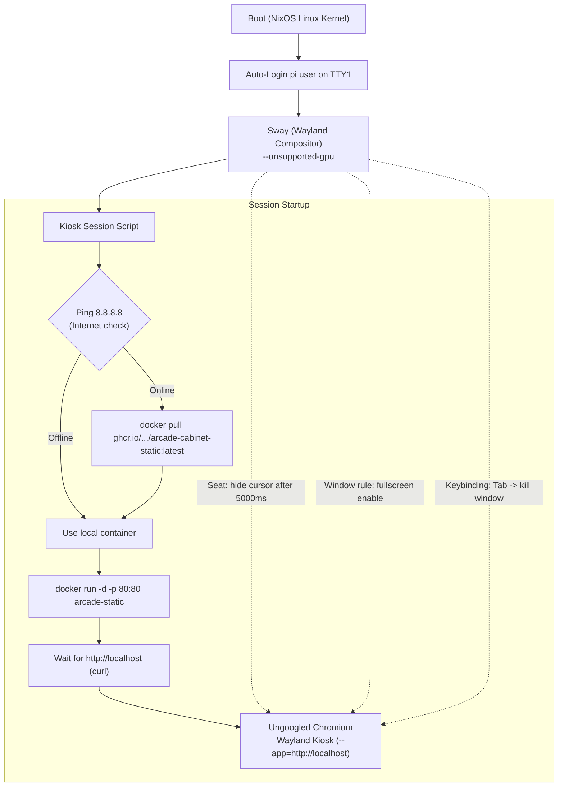

# Raspberry Pi Client & NixOS Arcade Operating System

The physical arcade cabinet is driven by a **Raspberry Pi 5** running a custom declarative **NixOS** configuration managed via **Nix Flakes** (`code/client/flake.nix`).

The operating system is tailored specifically for unattended arcade kiosk operation: it boots directly into a Wayland fullscreen web kiosk, updates itself on boot whenever network access is available, connects to physical arcade controls via an Ultimarc I-PAC 2 interface, and protects the SD card against file system corruption using an immutable tmpfs root.

---

## 1. Directory & File Overview

```text
code/client/
├── flake.nix      # Complete NixOS system definition, kiosk service, hardware mapping
├── flake.lock     # Locked dependencies (nixpkgs, nixos-raspberrypi, impermanence)
└── README.md      # Practical setup, building, and flashing guide
```

---

## 2. NixOS Flake Architecture

The flake leverages community modules for Raspberry Pi hardware support and system immutability:

- **`nixpkgs`**: Locked to NixOS 25.11.
- **`nixos-raspberrypi`**: Specialized kernel, bootloader (u-boot / firmware), and GPU drivers (`vc4` / VideoCore GPU acceleration).
- **`impermanence`**: Manages persistent state while keeping the root file system ephemeral in RAM.
- **`nixos-images`**: Builds SD card disk images directly from Nix derivations.

### Output Configurations
The flake produces two primary configurations:
1. **`rpi5` (Mutable)**: For development and testing. Enables live network updates via SSH (`nixos-rebuild switch`) without reflashing the SD card.
2. **`rpi5-immutable` (Production)**: Read-only, ephemeral root file system. Highly recommended for the public arcade machine to guarantee survival across power cutoffs.
2. **`rpi5-immutable` (Production)**: Read-only, ephemeral root file system. Highly recommended for the public arcade machine:
   - **Power-off safety**: Guarantees survival across sudden power cutoffs without SD card corruption.
   - **Kiosk escape & tamper resilience**: In a public university setting, if a user manages to break out of the Chromium kiosk instance and access a terminal, any damage or system modifications they perform will be completely reverted upon reboot.

---

## 3. Kiosk Service & Display Pipeline

The arcade cabinet bypasses traditional desktop environments (like X11, GNOME, or KDE) in favor of a lean, Wayland-native kiosk stack:



### 3.1. Sway (Wayland Compositor)
Defined in [`nixosModules.docker`](../code/client/flake.nix#L50-L158):
- **Window Rules**: Forces all opened windows to fullscreen with zero borders (`default_border none`).
- **Cursor Autohide**: `seat * hide_cursor 5000` hides the mouse cursor automatically after 5 seconds of inactivity.
- **Keyboard Layout**: Configured for the Belgian standard layout (`be-latin1` / `be`).
- **Emergency / Exit Keybinding**:
  ```text
  bindsym Tab kill
  ```
  Arcade cabinets often lack a keyboard. An arcade button wired to the `Tab` scancode will immediately kill the active game window and return the machine to the home screen.

### 3.2. Session Startup Script
Executed automatically when Sway starts:
1. **Connectivity Check**: Pings `8.8.8.8` once per second for up to 30 seconds.
2. **Container Update**: If online, it executes:
   ```bash
   docker pull ghcr.io/thomas-more-digital-innovation/arcade-cabinet-static:latest
   ```
   Dangling images are pruned (`docker image prune -f`) to prevent the SD card storage from filling over time.
3. **Container Launch**: Runs the Nginx container exposing port 80:
   ```bash
   docker run -d --name arcade-static -p 80:80 ghcr.io/thomas-more-digital-innovation/arcade-cabinet-static:latest
   ```
4. **Health Wait**: Polls `http://localhost` with `curl` until Nginx responds with HTTP 200.
5. **Kiosk Browser**: Spawns `ungoogled-chromium` with aggressive caching and kiosk flags:
   - `--kiosk --ozone-platform=wayland`
   - `--enable-gpu-rasterization --enable-zero-copy`
   - `--disable-infobars --noerrdialogs --disable-session-crashed-bubble`
   - `--app="http://localhost"`

---

## 4. Hardware Controls & Ultimarc I-PAC 2 Mapping

The physical arcade joysticks and pushbuttons are wired to an **Ultimarc I-PAC 2**, which acts as a USB HID keyboard encoder.

### 4.1. Hardware Scancode Remapping via `udev.extraHwdb`
In NixOS, key mappings are enforced at the Linux kernel input subsystem level using `systemd-hwdb`. This ensures scancodes are converted before reaching Wayland or Chromium:

```nix
services.udev.extraHwdb = ''
  # Match by input device name
  evdev:name:Ultimarc I-PAC 2:*
    KEYBOARD_KEY_700e0=enter
'';
```

- `evdev:name:Ultimarc I-PAC 2:*`: Matches the USB encoder by device name.
- `KEYBOARD_KEY_700e0=enter`: Remaps USB scancode `700e0` (Left Control / Button 1) to Linux keycode `enter`.

### 4.2. Debugging & Adding Custom Mappings
1. Connect via SSH to the Raspberry Pi:
   ```bash
   ssh root@<IP_ADDRESS>
   ```
2. Run `evtest` to monitor physical button presses:
   ```bash
   sudo evtest
   ```
3. Select the device number corresponding to `"Ultimarc I-PAC 2"`.
4. Press the target button on the arcade cabinet and observe the event log:
   ```text
   Event: time ..., type 4 (EV_MSC), code 4 (MSC_SCAN), value 700e1
   ```
5. Add the lowercase hex code (`700e1`) to `code/client/flake.nix` under `services.udev.extraHwdb`:
   ```nix
   services.udev.extraHwdb = ''
     evdev:name:Ultimarc I-PAC 2:*
       KEYBOARD_KEY_700e0=enter
       KEYBOARD_KEY_700e1=space
   '';
   ```

---

## 5. Storage Resilience & Impermanence

Arcade cabinets in public areas or universities are frequently powered off by cutting the main power switch rather than executing a graceful operating system shutdown. This typically destroys traditional ext4 or FAT filesystems on SD cards.

### 5.1. How the Immutable Configuration Works
In `flake.nix` under `self.nixosModules.immutable`:
- **Root Filesystem (`/`)**: Mounted in RAM on a `tmpfs` with a 512MB limit.
- **Nix Store (`/nix`)**: Read-only bind mount from the SD card (`/mnt-root/nix`).
- **Firmware (`/boot/firmware`)**: Mounted read-only / automounted on demand.

### 5.2. State Persistence via Impermanence
The `impermanence` module selectively binds only essential stateful paths to `/mnt-root/persist`:
- System state: `/var/log`, `/var/lib/nixos`, `/var/lib/systemd/coredump`.
- Network state: `/var/lib/NetworkManager`, `/var/lib/bluetooth`.
- Docker containers & layers: `/var/lib/docker`.
- SSH Host keys: `/etc/ssh/ssh_host_*`.
- Browser state: `/home/pi/.config/chromium`.

All other root file system writes remain in volatile memory and vanish upon reboot. The SD card remains pristine and uncorrupted indefinitely.

### 5.3. Kiosk Breakout & Tamper Protection
Because the arcade machine is deployed in a publicly accessible university environment, kiosk breakouts represent a realistic security concern:
- If a user triggers an unhandled browser shortcut, exploits a Chromium bug, or accesses a terminal, they could execute commands and attempt to tamper with the system.
- On standard Linux distributions, malicious modifications, deleted system binaries, or configuration tampering would persist and incapacitate the cabinet.
- With the **`rpi5-immutable`** setup, all modifications made outside the explicit persistence paths live entirely in volatile RAM (`tmpfs`). Any changes, dropped files, or system damage are completely discarded upon reboot, instantly restoring the system to its clean, declarative NixOS state.

---

## 6. Building, Flashing & Updating

### 6.1. Build Options
Images are built on any machine with Nix and Flakes enabled:

| Target Variant | Build Command | Use Case |
| :--- | :--- | :--- |
| **Mutable Compressed** | `nix build .#sdImages.rpi5 --print-build-logs` | Development SD card |
| **Mutable Uncompressed**| `nix build .#sdImages.rpi5-uncompressed --print-build-logs` | Quick local flashing |
| **Immutable Compressed** | `nix build .#sdImages.rpi5-immutable --print-build-logs` | Production cabinet SD card |
| **Immutable Uncompressed**| `nix build .#sdImages.rpi5-immutable-uncompressed --print-build-logs` | Direct production flash |

### 6.2. Flashing the SD Card
The resulting image is located at `result/sd-image/`:

```bash
# Compressed image (.img.zst)
zstdcat result/sd-image/*.img.zst | sudo dd of=/dev/sdX bs=4M status=progress conv=fsync

# Uncompressed image (.img)
sudo dd if=result/sd-image/*.img of=/dev/sdX bs=4M status=progress conv=fsync
```

### 6.3. Remote Updating over SSH (Mutable Image)
To push NixOS updates across the local network without removing the SD card:

```bash
nixos-rebuild switch --flake .#rpi5 --target-host root@<IP_ADDRESS> --option filter-syscalls false
```
*(Default credentials: User `root` / Pass `nixos`, or User `pi` / Pass `pi`)*

