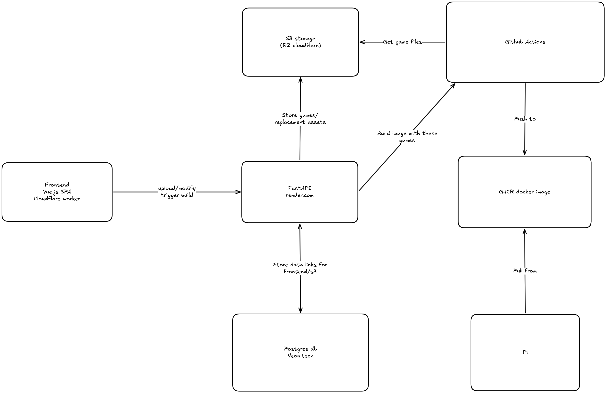
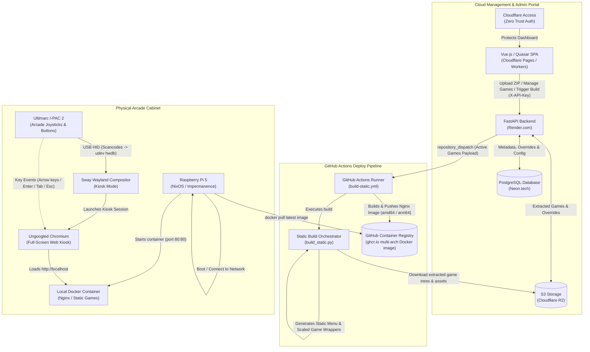

# UA Arcade Cabinet - Project Documentation

Welcome to the central documentation hub for the **UAntwerpen Arcade Cabinet** ("UAntwerpen Arcade kast"). This repository contains the complete code, declarative operating system configuration, and deployment infrastructure for the interactive retro arcade cabinet built for the **University of Antwerp** by the **Thomas More Digital Innovation** team.

---

## 1. System Overview

The frontend is built in **Vue.js** with the **Quasar framework** for ease of use and responsive design. It is deployed as a Single Page Application (SPA) on **Cloudflare Pages / Workers** and protected with **Cloudflare Access** (Zero Trust authentication). The backend is built in Python using **FastAPI** and **SQLAlchemy** (hosted on **Render.com**), secured with API key validation (`X-API-Key`). The database is deployed on **Neon.tech**, a serverless PostgreSQL provider. The game files and asset overrides are stored in an S3-compatible bucket on **Cloudflare R2**.

The physical arcade cabinet is powered by a **Raspberry Pi 5** running a custom, declarative **NixOS** configuration with an immutable (stateless) root filesystem in RAM, a **Sway (Wayland)** kiosk session, and physical arcade joysticks and buttons connected via an **Ultimarc I-PAC 2** USB interface.

### Architecture Diagram





---

## 2. About the GitHub Actions Deploy Pipeline

The backend contains a reference to a private key (`.pem`) generated from a **GitHub App** that acts to trigger the Docker build workflows:
- **GitHub App Permissions**:
  - **Actions**: `Read-only` access (workflows, workflow runs, and artifacts to monitor build progress).
  - **Contents**: `Read and write` access (repository contents, commits, branches, downloads, releases, and merges to dispatch repository events).
- **Deployment Credentials**:
  To deploy and trigger this, the backend requires:
  1. **Private Key**: The `.pem` file downloaded from the GitHub App settings (e.g. `code/backend/private/ua-arcade-deploy.private-key.pem`).
  2. **App ID**: Located at the top of the General Settings page for the GitHub App.
  3. **Installation ID**: Found in the URL once the app is installed in the organization (for example: `https://github.com/organizations/Thomas-More-Digital-Innovation/settings/installations/<installation-id>`).

When an administrator clicks **"Update Pi"** in the web dashboard, the backend gathers active games and asset overrides from PostgreSQL, authenticates as the GitHub App, and triggers a `repository_dispatch` event on the repository. The GitHub Actions runner executes `build_static.py`, compiles the static offline games into an Alpine Nginx image, and pushes it to GHCR.

---

## 3. Detailed Documentation Index

For in-depth explanations, configuration files, and technical guides, refer to the following documents:

| Document | Focus & Contents |
| :--- | :--- |
| **[System Architecture](ARCHITECTURE.md)** | End-to-end architecture, component contracts, security model (Cloudflare Access & API keys), and offline kiosk design. |
| **[Backend & Storage Specification](BACKEND.md)** | FastAPI backend, environment variables, SQLAlchemy models (ERD), Cloudflare R2 layout, automated Internet Asset Localization engine, dynamic asset overrides, and complete API endpoint reference. |
| **[Frontend Management Portal](FRONTEND.md)** | Vue 3 + Quasar dashboard, Cloudflare Workers / Pages deployment, ZIP game uploads, Asset Inspector with pixel dimension checks and audio preview, in-browser arcade emulator, and deployment progress modal. |
| **[Raspberry Pi Client & NixOS](CLIENT_PI_NIXOS.md)** | Raspberry Pi 5 hardware guide, Nix Flake architecture, Sway Wayland kiosk, Ultimarc I-PAC 2 udev hwdb key remapping, debugging button scancodes with `evtest`, stateless tmpfs root + impermanence, and power-outage protection. |
| **[Static Build & Container Deployment](BUILD_AND_DEPLOYMENT.md)** | `build_static.py` orchestrator, responsive wrapper generation (`GameWrapper.js`), arcade home screen generation with 8-bit font, Dockerfile.static & nginx.conf, multi-arch GHCR publishing, and local preview testing. |

---

## 4. Repository Structure

```text
.
├── code/
│   ├── backend/               # FastAPI backend, static site builder, and home-screen templates
│   │   ├── build_static.py    # Offline static site generator
│   │   ├── Dockerfile.static  # Alpine Nginx container definition
│   │   ├── nginx.conf         # Static Nginx server configuration
│   │   ├── pyproject.toml     # Python dependencies & packaging
│   │   └── src/               # Application code (API, DB models, storage, S3 localizer)
│   ├── client/                # NixOS declarative configuration for the Raspberry Pi
│   │   ├── flake.nix          # System definition, Sway kiosk, Docker runner, udev keymaps
│   │   └── README.md          # Flashing, building, and hardware debugging instructions
│   └── frontend/              # Vue 3 / Quasar management portal
│       ├── src/               # Vue components, pages, stores, and layouts
│       ├── quasar.config.ts   # Quasar & Vite configuration
│       └── wrangler.jsonc     # Cloudflare Workers / Pages deployment config
├── documents/                 # Architecture, specifications, diagrams, and project logs
│   ├── README.md              # Central documentation hub (this file)
│   ├── ARCHITECTURE.md        # Detailed system architecture
│   ├── BACKEND.md             # Backend architecture & API reference
│   ├── FRONTEND.md            # Frontend management portal documentation
│   ├── CLIENT_PI_NIXOS.md     # Raspberry Pi & NixOS hardware setup guide
│   ├── BUILD_AND_DEPLOYMENT.md# Static build & CI/CD deployment guide
│   ├── diagram.png            # Architecture diagram (compact)
│   ├── pictures/              # High-resolution architectural drawings
│   │   └── architecture-diagram-ua.png
│   ├── client/                # Client-provided assets and requirements
│   ├── files/                 # Generated project files and specifications
│   └── meetings/              # SCRUM sprint notes and standups
└── .github/
    └── workflows/
        ├── build-static.yml   # Multi-arch Docker build & push workflow
        ├── backend-quality.yml# Backend linting & tests
        └── frontend-quality.yml# Frontend linting & tests
```

---

## 5. Development & Quickstart

### Running the Backend Locally
```bash
cd code/backend
python3 -m venv .venv
source .venv/bin/activate
pip install -e .
uvicorn src.app.main:app --reload --port 8000
```

### Running the Frontend Locally
```bash
cd code/frontend
npm install
quasar dev
```

### Building & Previewing the Static Site Locally
```bash
cd code/backend
python3 build_static.py
cd dist
python3 -m http.server 8080
# Visit http://localhost:8080
```

### Building the Raspberry Pi NixOS SD Card Image
```bash
cd code/client
# For development (mutable, network updatable over SSH):
nix build .#sdImages.rpi5 --print-build-logs

# For production (immutable, power-safe):
nix build .#sdImages.rpi5-immutable --print-build-logs
```
